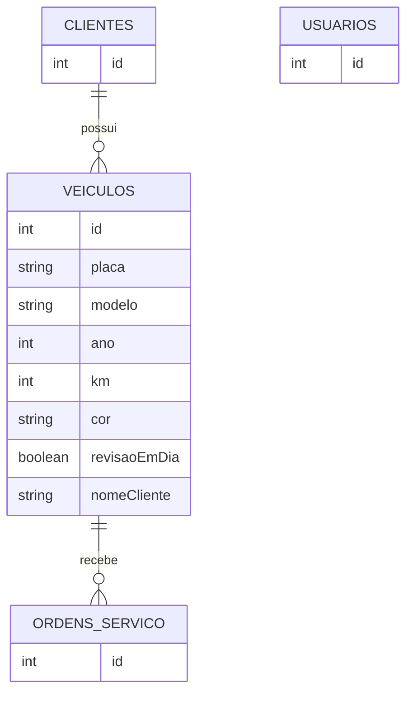

# Diagrama das entidades

Este diagrama evolui junto com o projeto: na Parte 1 mostra a entidade principal com todos os campos, e nas partes seguintes ganha as demais entidades e os relacionamentos.

## Como ler

- Cada bloco com `{ }` é uma entidade, e cada linha dentro dele é um campo, com o tipo antes do nome (`int`, `string`, `boolean`).
- A linha `CLIENTES ||--o{ VEICULOS : possui` significa que **um** cliente possui **vários** veículos.
- Nesta parte, só a entidade principal (`VEICULOS`) precisa ter os campos detalhados. As outras aparecem apenas com o `id`.

## Entidades planejadas

| Entidade | Para que serve | Parte prevista |
|---|---|---|
| `veiculos` | Armazena os carros atendidos na oficina mecânica | Parte 1 |
| `clientes` | Guarda os dados dos proprietários dos veículos | Parte 2 |
| `ordens_servico` | Registra os consertos, peças e valores de cada atendimento | Parte 2 |
| `usuarios` | Quem faz login no sistema (mecânicos e atendentes) | Parte 3 |